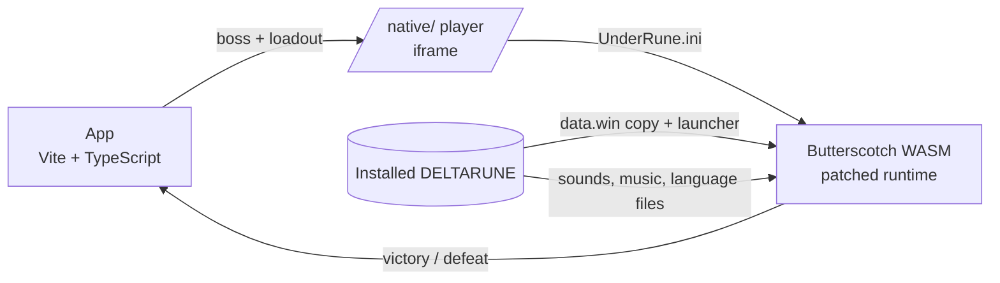

# UnderRune

A local web app that plays DELTARUNE boss battles in the browser using **the installed game's own code and files**. Built as a graduation project, with [shadowcrystal.dev](https://shadowcrystal.dev/) as the reference experience.

> Fan project, not affiliated with Toby Fox or DELTARUNE. This repository contains **no** game files, extracted art, audio or decompiled code. You need a legally owned copy of the game installed on your computer.

## What it does

- **Theater intro:** a big CRT on a stage split between UNDERTALE (red curtain, warm light, Frisk) and DELTARUNE (blue curtain, green-tinted light, Kris). Pressing a side's remote turns the TV on and sweeps that side's theme across the stage. UNDERTALE shows its logo with *coming soon*; DELTARUNE connects to the device.
- **Device room and boss select:** 49 encounters (main, secret and minibosses), grouped by chapter.
- **Battle preparation:** after choosing a boss, a side panel lets you equip weapons and armor on each character and fill the 12-slot item bag. Every piece of equipment and every item, with its name, description and stats, is read from the game's own data.
- **Original battles:** the battle runs the original bytecode from the game's `data.win` on the open-source [Butterscotch](https://github.com/ButterscotchRunner/Butterscotch) GameMaker runner (WebAssembly). Attacks, dialogue, music and phases are not rewritten.
- **Outcome:** victory and defeat are detected; won battles are marked in the menu.
- **Adaptation mode:** a browser re-implementation remains for drilling a single attack pattern (`PRACTICE [T]`); without the native runtime, every battle falls back to it.

## How it works



- **Launcher** (`tools/utmt/build-native-launcher.csx`): in a **copy** of each chapter's `data.win`, only the startup step and the test room's creation code change. The chosen encounter starts through the game's own `scr_battle` call. Battle code, bosses and every other script stay untouched; the installed game's file hashes are verified on every build.
- **Party:** each encounter's party is derived from the game code and stored with its evidence in `src/bosses/parties.json`. For example, Susie fights Hammer of Justice alone, and Kris and Ralsei face Susie & Lancer. Raw evidence lives in `docs/encounter-parties.json`.
- **Runtime patch** (`runtime/patches/browser-compat.patch`): adds missing APIs such as positional audio and texture repeat. GameMaker's GLSL ES 1.00 shaders are compiled as GLSL ES 3.00 on WebGL2, so palette swappers and blur effects work.
- **Browser support:** browsers with JSPI get the fast runtime; others get the portable (Asyncify) runtime automatically.

## Requirements

- Windows 10/11, [Node.js](https://nodejs.org/) 24+, Git
- DELTARUNE installed through Steam (default path `C:/Program Files (x86)/Steam/steamapps/common/DELTARUNE`; set `DELTARUNE_DIR` if yours differs)
- Optional: UNDERTALE through Steam for the theater's Frisk, logo and font (`UNDERTALE_DIR`); without it the theater uses text
- About 3 GB of free disk space (extracted data, launchers and build tools all stay inside the project)

## Setup and running

```powershell
npm install
npm run prepare:game    # inventory, sprites and code from the game (read-only)
npm run setup:native    # party/equipment data, runtime build and chapter launchers
npm run dev             # http://127.0.0.1:5173
```

The first `setup:native` run downloads and builds Butterscotch with a project-local Emscripten. All generated files are covered by `.gitignore`.

## Controls

| Key | Action |
| --- | --- |
| Arrow keys | Move and navigate menus |
| Z / Enter | Confirm |
| X / Shift | Cancel / move slowly |
| C | Menu (in game) |
| P | Pause |

On touch screens, a d-pad and Z/X buttons appear.

## Verification

```powershell
npm test               # unit tests (engine, preparation, bridge)
npm run test:tools     # extraction, catalog and party tests
npm run test:e2e       # end-to-end in the browser, including original Jevil and Lancer battles
npm run audit:native   # opens all 49 encounters one by one; screenshots and runtime diagnostics in .tools/native-census/
```

## Known limitations

- Battles start from the game's test room instead of from inside the story, so the cutscenes before and after a battle do not play (except where the battle's own intro is the scene: Jevil, Shadow Mantle and Susiezilla).
- Character stats are each chapter's starting values.
- Butterscotch is an independent re-implementation of GameMaker. A few platform-specific calls, such as fullscreen and display size, have no browser equivalent; they do not affect battles and can be inspected with `?debug`.
- There is no public web version yet; game files must be read from the user's own computer.

## Credits and licenses

- UNDERTALE and DELTARUNE © Toby Fox. No game files are included in this repository.
- [Butterscotch](https://github.com/ButterscotchRunner/Butterscotch): AGPL-3.0. Our changes are published in `runtime/patches/browser-compat.patch`.
- [UndertaleModTool](https://github.com/UnderminersTeam/UndertaleModTool) / Underminers Team: data extraction and launcher builds.
- [GameMaker HTML5 runtime](https://github.com/YoYoGames/GameMaker-HTML5): Apache-2.0 (compatibility experiments).
- Interface reference: [shadowcrystal.dev](https://shadowcrystal.dev/) / RADI0.
