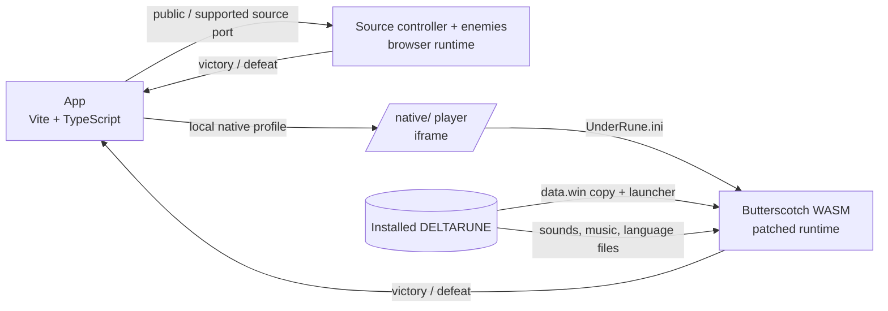

# UnderRune

**[Play the browser demo](https://kaanalper.github.io/UnderRune/play/) · [Project and development previews](https://kaanalper.github.io/UnderRune/)**

A DELTARUNE fan project with a theater intro, a boss card deck, party preparation and browser boss battles. The public demo includes Jevil, opening Lancer, standalone Clover and both K.Round encounters with shared commands and continuous turns, plus 16 separate Jevil practice patterns. The local development app also runs battles using the installed game's code and files. Built as a graduation project, with [shadowcrystal.dev](https://shadowcrystal.dev/) as the reference experience.

> Fan project, not affiliated with Toby Fox or DELTARUNE. The source branch excludes extracted art, audio and game packages. The Pages demo includes selected sprites and music, credited to Toby Fox; full game packages, bytecode and decompiled code are excluded. Playing the public demo requires no installation. Local development requires your own installed copy.

## Public demo

Press **PLAY**, choose the DELTARUNE remote, connect through the TV, and select Chapter 1. Browse the cards with left/right or swipe, or use Find a boss. Jevil, Lancer (encounter 2), Clover (encounter 8) and K.Round (encounters 12 and 27) are playable. Choose Prepare party, equip weapons and armor, pack your bag, then choose START BATTLE. Characters appear on the left and the bottom menu offers FIGHT, ACT/MAGIC, ITEM, SPARE and DEFEND. Enemy turns return to the command menu. Prepared usable items can be consumed in battle. PRACTICE is a separate Jevil launch for a selected pattern. Other encounters have equipment previews with launch disabled.

`npm run build:pages` builds the public app under `dist-pages/play/` and the landing page at `dist-pages/index.html`, using an explicit asset allowlist. Deploy this output over the existing `gh-pages` branch while preserving its `clips/` directory. Local previews can enter public mode with `?demo=1`.

## What it does

- **Theater intro:** a big CRT on a stage split between UNDERTALE (red curtain, warm light, Frisk) and DELTARUNE (blue curtain, green-tinted light, Kris). Pressing a side's remote turns the TV on and sweeps that side's theme across the stage. UNDERTALE shows its logo with *coming soon*; DELTARUNE connects to the device.
- **Device room and boss select:** 49 source encounter records (main, secret and minibosses), grouped by chapter in a playing-card deck. A source record may be an alternate or unused encounter; inclusion does not establish normal story reachability.
- **Battle preparation:** after choosing a boss, a side panel lets you equip weapons and armor on each character and fill the 12-slot item bag. Every piece of equipment and every item, with its name, description and stats, is read from the game's own data.
- **Public battles:** TypeScript ports of the game's controller, party, writers and supported enemies run on a browser GameMaker runtime subset, including queued commands, per-character timing lanes and source enemy attacks. Native frame recordings verify selected gameplay traces.
- **Local original battles:** with native launchers installed, the battle runs the original bytecode from the game's `data.win` on the open-source [Butterscotch](https://github.com/ButterscotchRunner/Butterscotch) GameMaker runner (WebAssembly).
- **Outcome:** victory and defeat are detected; won battles are marked in the menu.
- **Source practice:** Jevil's separate practice mode (`PRACTICE [T]`) uses the source attack objects. Without a local native profile, supported encounters run on the source engine; unsupported encounters keep preparation previews with launch disabled. The former generic approximation engine has been removed.

## How it works



- **Launcher** (`tools/utmt/build-native-launcher.csx`): in a **copy** of each chapter's `data.win`, only the startup step and the test room's creation code change. The chosen encounter starts through the game's own `scr_battle` call. Battle code, bosses and every other script stay untouched; the installed game's file hashes are verified on every build.
- **Party:** each encounter's party is derived from the game code and stored with its evidence in `src/bosses/parties.json`. For example, Susie fights Hammer of Justice alone, and Kris and Ralsei face Susie & Lancer. Raw evidence lives in `docs/encounter-parties.json`.
- **Runtime patch** (`runtime/patches/browser-compat.patch`): adds missing APIs such as positional audio and texture repeat. GameMaker's GLSL ES 1.00 shaders are compiled as GLSL ES 3.00 on WebGL2, so palette swappers and blur effects work.
- **Browser support:** browsers with JSPI get the fast runtime; others get the portable (Asyncify) runtime automatically.

## Requirements

- Windows 10/11, [Node.js](https://nodejs.org/) 24+, Git
- DELTARUNE installed through Steam (default path `C:/Program Files (x86)/Steam/steamapps/common/DELTARUNE`; set `DELTARUNE_DIR` if yours differs)
- Optional: UNDERTALE through Steam for the theater's Frisk, logo and font (`UNDERTALE_DIR`); without it the theater uses text
- About 3 GB of free disk space (extracted data, launchers and build tools all stay inside the project)

## Setup and running

```powershell
npm install
npm run prepare:game    # inventory, sprites and code from the game (read-only)
npm run prepare:source  # collision masks, equipment and supported browser source battles
npm run setup:native    # optional: original runtime build and chapter launchers for local verification
npm run dev             # http://127.0.0.1:5173
```

The first `setup:native` run downloads and builds Butterscotch with a project-local Emscripten. All generated files are covered by `.gitignore`.

## Controls

| Key | Action |
| --- | --- |
| Arrow keys | Move and navigate menus |
| Z / Enter | Confirm |
| X / Shift | Cancel / move slowly |
| C | Menu (in game) |
| P | Pause |

On touch screens, a d-pad and Z/X buttons appear.

## Verification

```powershell
npm test               # unit tests (engine, preparation, bridge)
npm run test:tools     # extraction, catalog and party tests
npm run test:e2e       # end-to-end in the browser, including original Jevil, Lancer and Clover battles
npm run audit:native   # opens all 49 encounters one by one; screenshots and runtime diagnostics in .tools/native-census/
```

## Known limitations

- Battles start from the game's test room instead of from inside the story, so the cutscenes before and after a battle do not play (except where the battle's own intro is the scene: Jevil, Shadow Mantle and Susiezilla).
- Character stats are each chapter's starting values.
- Butterscotch is an independent re-implementation of GameMaker. A few platform-specific calls, such as fullscreen and display size, have no browser equivalent; they do not affect battles and can be inspected with `?debug`.
- The public version includes shared battle flow for Jevil, opening Lancer, standalone Clover and both K.Round encounters. Numerical attack rules and recorded bullet patterns come from the game; full visual, sound and special equipment-ability parity remains under verification. Native local battle checks and recorded attack comparisons do not establish identical behavior across every original game scene. Spamton NEO is being ported and is not publicly playable yet.

## Credits and licenses

- UNDERTALE and DELTARUNE © Toby Fox. Sprites and music in the public demo retain their original authorship; they are not covered by the project's code license.
- [Butterscotch](https://github.com/ButterscotchRunner/Butterscotch): AGPL-3.0. Our changes are published in `runtime/patches/browser-compat.patch`.
- [UndertaleModTool](https://github.com/UnderminersTeam/UndertaleModTool) / Underminers Team: data extraction and launcher builds.
- [GameMaker HTML5 runtime](https://github.com/YoYoGames/GameMaker-HTML5): Apache-2.0 (compatibility experiments).
- Interface reference: [shadowcrystal.dev](https://shadowcrystal.dev/) / RADI0.
